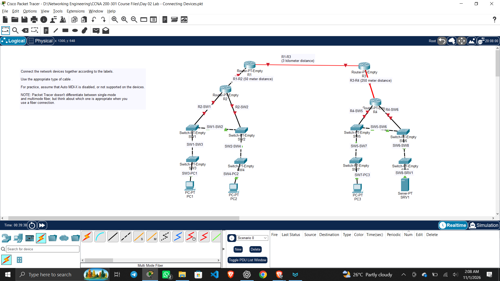

# Connecting Devices

1. PC to Switch is Copper Straight Through Cable on FastEthernet

2. Choose any ports as needed

3. Switch to Switch is Crossover (Assuming the devices are not Auto MDIX compatible)

4. Switch to Router is Copper Straight Through Cable

5. Router to Router on 50m is Copper Crossover UTP cable but we use Fiber Optic when the distance is more than 100m. For distance not exceeding 3 Km we use Multimode, and we use Single mode for 3 KM distance.

### Problem

I faced a unique problem in the latest Cisco Packet Tracer. The instructor used the old version of PT which didnt have any option to choose SingleMode and Multimode Fiber Optic Cable separately but the latest one has it.

When I tried to connect 2 routers 3 km apart with a SM Fiber Cable the software said I cant connect it to the Gigabit port of it(Gigabit is needed since its a long distance network) 

I searched on Google and ChatGPT for the fix and found out I need to physically(In PT) install and SFP on that router to use Gigabit fiber port. It was quite interesting.

______

### Installation steps

- Select the Router and go to physical device section.

- Select `PT-ROUTER-NM-1FGE-SM` from the left module list.

- Turn off Router using its physical power switch. (I was shocked here BTW)

- Drag the module into one of the empty module bays.

- Turn Router back on.

- Repeat the same process for other Router.

- Select the **Single Mode Fiber** cable and connect the newly installed interfaces.

## Understanding the naming convention

`PT-ROUTER-NM-1FGE-SM`

| Part   | Meaning              |
| ------ | -------------------- |
| PT     | Packet Tracer        |
| ROUTER | Designed for routers |
| NM     | Network Module       |
| 1      | One interface/port   |
| F      | Fibre                |
| GE     | Gigabit Ethernet     |
| SM     | Single Mode          |

## 2. Common abbreviations

These are the important ones to remember:

| Abbreviation | Meaning                   |
| ------------ | ------------------------- |
| NM           | Network Module            |
| C            | Copper                    |
| F            | Fiber                     |
| FE           | Fast Ethernet (100 Mbps)  |
| GE           | Gigabit Ethernet (1 Gbps) |
| 10GE         | 10 Gigabit Ethernet       |
| SM           | Single Mode               |
| MM           | Multimode                 |
| 1            | One port/interface        |
| 4            | Four ports/interfaces     |

| Module               | Interpretation                                   |
| -------------------- | ------------------------------------------------ |
| PT-ROUTER-NM-1AM     | One asynchronous interface                       |
| PT-ROUTER-NM-1CE     | One copper Ethernet interface                    |
| PT-ROUTER-NM-1CFE    | One copper Fast Ethernet interface               |
| PT-ROUTER-NM-1CGE    | One copper Gigabit Ethernet interface            |
| PT-ROUTER-NM-1FFE    | One fibre Fast Ethernet interface                |
| PT-ROUTER-NM-1FGE    | One fibre Gigabit Ethernet interface             |
| PT-ROUTER-NM-1FGE-SM | One single-mode fibre Gigabit Ethernet interface |
| PT-ROUTER-NM-1S      | One serial interface                             |
| PT-ROUTER-NM-1SS     | One Smart Serial interface                       |

## Remember these distinctions

- **Copper vs Fibre:** C vs F.

- **Fast Ethernet vs Gigabit Ethernet:** FE vs GE.

- **Single-mode vs Multimode:** SM vs MM.

- **Serial vs Ethernet:** S vs E/FE/GE.

