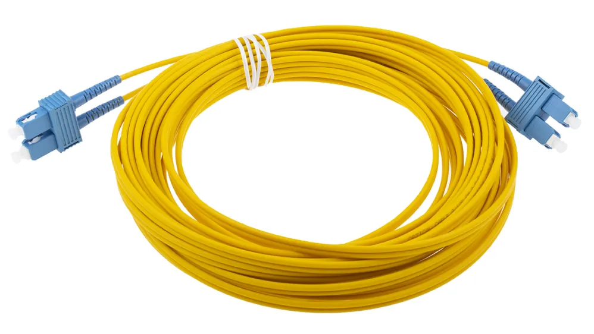

# Interface And Cables

______

### Interfaces

______

### Connectors

- RJ45 (Registered Jack)

______

### Ethernet

Ethernet is a collection of network protocols/standard.

### Ethernet Standards

Defined in IEEE 802.3 Standard in 1983

Here T means Twisted Pair and for length we can use more than 100m but for performance and reliability 100m is chosen to be the standard length. Common name is used multiple times for each cable type.

______

### UTP Cables

Copper cables used in ethernet standard are called UTP cables.

> U - Unshielded (Has no metallic shield, face interference from nearby devices)

> T - Twisted ( Twist protects from electromagnetic interference MEI)

> P - Pair (4 pairs of cable twisted together)

The cable has total 8 wires  inside in total and every 2 wires are twisted with each other and all 4 pairs are also twisted with each other.

______

## RJ45 Connector

The RJ45 connector has total 8 pins but not all cables use all 8 of them

10BASE-T  ----->  2 Pairs (4 Wires)

100BASE-T  ----->  2 Pairs (4 Wires)

1000BASE-T  ----->  4 Pairs (8 Wires)

10GBASE-T  ----->  4 Pairs (8 Wires)

______

### Network Protocols

... is a mutual agreement between 2 different devices that uses their own language for themselves but communicate each other in a same language or method.

Example: Switch to PC connection is always done on RJ45 port and RJ45 connector. We can use USB for that too but RJ45 is industry standard and is used everywhere, and so it is a standard protocol for network connectivity.

______

### Bits and Bytes

**Bits**

Computer sends and receives data in binary (0 and 1) 

When we use copper ethernet cable to download something the host server sends electrical signal in bits and the receiving device interprets the data and shows us the data.

- 0

- 1

Each value of 0 or 1 is a bit

---

**Byte**

- 0

- 1

- 0

- 0

- 1

- 0

- 1

- 1

8 Bits = 1 Byte

---

**Network speed is always counted as bits not Bytes**

Example 100 Mbps,  2.6 Gbps

.

**Measurement of Bits**

1 kb = 1,000 bits

1 mb = 1,000,000 bits

1 gb = 1,000,000,000 bits

1 tb = 1,000,000,000,000 bits

.

**MBps is basically 8 times of bits and its used in measuring speeds of devices like harddrive**

---

### Cable Connections

**10BASE-T and 100BASE-T** UTP Cable

---

- PC to Switch

**Full Duplex ->** A connection that sends and receives data simultaneously.

---

- Switch to Router

______

For **10BASE-T (10 Mbps Ethernet)**, only two twisted pairs are used

| Pins | Function (MDI) |
| ---- | -------------- |
| 1, 2 | Transmit (TX)  |
| 3, 6 | Receive (RX)   |

### 1. MDI (End devices)

Devices such as PCs and routers traditionally use MDI pin assignments.

- Pins 1, 2 → Transmit

- Pins 3, 6 → Receive

### 2. MDI-X (Switches and hubs)

Traditional switches use MDI-X, which reverses the transmit and receive assignments.

- Pins 1, 2 → Receive

- Pins 3, 6 → Transmit

### 3. Why is this distinction important?

When connecting two devices, their transmit and receive pairs must match.

For example:

**PC → Switch (straight-through cable)**

| PC (MDI)  | Switch (MDI-X) |
| --------- | -------------- |
| TX (1, 2) | RX (1, 2)      |
| RX (3, 6) | TX (3, 6)      |

This is why a traditional straight-through cable works between a PC and a switch.

Here is a chart of devices that uses different pins for TX and RX:

**For Home routers**

| Interface                      | Traditional configuration | TX pins | RX pins |
| ------------------------------ | ------------------------- | ------- | ------- |
| PC Ethernet                    | MDI                       | 1, 2    | 3, 6    |
| Router WAN                     | MDI                       | 1, 2    | 3, 6    |
| Router LAN (integrated switch) | MDI-X                     | 3, 6    | 1, 2    |
| Switch port                    | MDI-X                     | 3, 6    | 1, 2    |

**Remember for CCNA:**

- MDI: TX on 1, 2.

- MDI-X: TX on 3, 6.

- Auto-MDI/MDI-X: Automatically detects and adjusts the transmit/receive configuration.

One important detail: Modern switches generally support Auto-MDI/MDI-X, so you don't usually need to worry about choosing straight-through versus crossover cables.

### 1. MDI (Medium Dependent Interface)

Traditionally used by end devices such as:

- PCs

- Servers

- Routers

Pin assignment:

- Pins 1, 2 → TX

- Pins 3, 6 → RX

### 2. MDI-X (Medium Dependent Interface Crossover)

Traditionally used by:

- Switches

- Hubs

Pin assignment:

- Pins 1, 2 → RX

- Pins 3, 6 → TX

### 3. Why do we need two configurations?

Imagine connecting a PC directly to a switch.

The PC transmits through pins 1, 2. The switch must receive through pins 1, 2.

That's why their pin assignments are reversed.

______

- Router to Router

- Switch to Switch

______

**Straight Through Cable ->** When 2 devices have same type of cable with same RJ45 connector at the end

They have identical wiring in both sides, **Crossover Cables dont**

### 1. Straight-through vs Crossover

**Straight-through cable:**  
Both ends have identical wiring (T568A–T568A or T568B–T568B).

Pin mapping:

- 1 → 1

- 2 → 2

- 3 → 3

- 6 → 6

**Crossover cable:**  
One end uses T568A, and the other uses T568B.

Pin mapping:

- 1 → 3

- 2 → 6

- 3 → 1

- 6 → 2

---

Modern devices uses **Auto MDI_X** That doesnt require to use crossover cables

### Remember the distinction

- **MDI:** Traditional interface configuration.

- **MDI-X:** Traditional crossover interface configuration.

- **Auto-MDI/MDI-X:** Automatically detects and handles either configuration.

______

~~{Back after 2 hours of break}  :)~~

______

**1000BASE-T and 10GBASE-T** UTP Cable

## Ethernet cable comparison

| Ethernet standard | Speed    | Pairs used | Pins used  |
| ----------------- | -------- | ---------- | ---------- |
| 10BASE-T          | 10 Mbps  | 2          | 1, 2, 3, 6 |
| 100BASE-TX        | 100 Mbps | 2          | 1, 2, 3, 6 |
| 1000BASE-T        | 1 Gbps   | 4          | 1–8        |
| 10GBASE-T         | 10 Gbps  | 4          | 1–8        |

- All four pairs transmit and receive simultaneously.

- Each pair carries data in both directions.

- This is called **full-duplex bidirectional transmission**.

---

**1000BASE-T uses sophisticated signal processing, including *echo cancellation*, to distinguish incoming signals from outgoing signals on the same pairs.**

.

Quick Recap::

- **10BASE-T:** Two pairs, separate TX and RX.

- **100BASE-TX:** Two pairs, separate TX and RX.

- **1000BASE-T and 10GBASE-T:** Four pairs, simultaneous bidirectional transmission on every pair.

______

Copper cable can be used within 100m without issue or data loss, what about kilometers. Here comes Fiber Optic Cables

### Fiber Optic Connections

An **SFP transceiver** is a small, removable networking module that allows a switch or router to connect to different types of network media, such as fibre-optic cables or copper Ethernet cables.

SFP stands for **Small Form-factor Pluggable**.

## Why do we need SFP?

Imagine you have a switch with 24 RJ45 Ethernet ports.

You want to connect it to another building 500 metres away.

Regular copper Ethernet (1000BASE-T) has a maximum standard segment length of 100 meters.

so, Switch A → SFP module → Fiber optic cable → SFP module → Switch B  is the best choice

### Fiber Optic Cable

This cables sends light as a signal instead of electrical signal which travels at lightspeed and can carry a data packet from one corner of the world to another within seconds.

.

There are 2 cables in the image, 1 is used to transmit and the other is used to receive signals.

The fiber cable has 4 layers

1. The fiberglass core

2. Cladding that reflects light

3. A protective Buffer

4. The Outer jacket of the cable

______

### Single Mode and Multi Mode Fiber Optic Cable

## Physical structure

## How does light travel?

### Single-mode fiber

- Has a very narrow core.

- Allows only one propagation mode.

- Light travels with minimal modal dispersion.

- Supports very long-distance communication.

Typical applications:

- ISP backbone networks.

- Telecommunications.

- Long-distance connections between cities.

- FTTH networks.

### Multimode fiber

- Has a wider core.

- Supports multiple propagation modes.

- Different light modes can travel along different paths.

- Modal dispersion limits its effective transmission distance.

Typical applications:

- Data centres.

- Server rooms.

- Enterprise building networks.

- Short-distance connections between switches.

______

### Common Standards for Fiber Optics Cable

| Standard    | Fiber type             | Speed   | Maximum distance   |
| ----------- | ---------------------- | ------- | ------------------ |
| 1000BASE-SX | Multimode              | 1 Gbps  | 550 m              |
| 1000BASE-LX | Multimode, Single-mode | 1 Gbps  | 550m(MM), 5 km(SM) |
| 10GBASE-SR  | Multimode              | 10 Gbps | 400 m              |
| 10GBASE-LR  | Single-mode            | 10 Gbps | 10 km              |

______

| Feature                            | UTP Cable                             | Fiber Optic Cable                                                |
| ---------------------------------- | ------------------------------------- | ---------------------------------------------------------------- |
| Transmission medium                | Electrical signals                    | Light signals                                                    |
| Conductor                          | Copper wires                          | Glass or plastic fibre                                           |
| Structure                          | Twisted copper wire pairs             | Core surrounded by cladding                                      |
| Signal type                        | Electrical pulses                     | Light pulses                                                     |
| Common Ethernet categories         | Cat5e, Cat6, Cat6A                    | OS1, OS2, OM3, OM4, etc.                                         |
| Typical connectors                 | RJ45 (8P8C)                           | LC, SC, ST                                                       |
| Maximum standard Ethernet distance | Usually 100 meters                    | From hundreds of meters to tens of kilometers, depending on type |
| Speed                              | 1 Gbps, 2.5 Gbps, 10 Gbps, etc.       | 1 Gbps, 10 Gbps, 25 Gbps, 100 Gbps and beyond                    |
| EMI interference                   | Susceptible                           | Immune                                                           |
| Electrical conductivity            | Conducts electricity                  | Does not conduct electricity                                     |
| Signal attenuation                 | Generally higher over long distances  | Generally lower over long distances                              |
| Security                           | Can radiate electromagnetic signals   | Difficult to tap without detection                               |
| Installation                       | Relatively easy                       | Requires more specialised handling and termination               |
| Cost                               | Generally cheaper                     | Often more expensive overall                                     |
| Power delivery                     | Can support PoE                       | Cannot carry electrical power                                    |
| Common applications                | LANs, PCs, routers, switches, cameras | ISP backbones, FTTH, data centres, long-distance links           |

______

{End of Theory Part}

